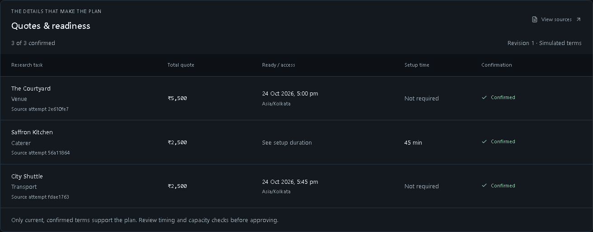

# CHORUS: judge's guide

CHORUS helps an event organizer coordinate venue, catering and transport research from one spoken or typed brief. It checks whether vendor terms fit the same budget, headcount and deadline, then presents a sourced plan for approval.

**Start here:** [pitch deck](https://docs.google.com/presentation/d/1kFYbbos2bv-y8siRZz47gnc-_F_a3I6LTuCYmKFEoC4/edit) · [run locally](README.md#run-locally) · [three-minute demonstration](DEMO.md) · [verification](VERIFICATION.md)

The complete supported workflow runs in simulation with no telephone number or provider account. A fresh checkout generates a private local sign-in password during setup. The separately configured operator account and its credentials are not needed to evaluate a fresh installation.

*Actual application screenshot with simulated vendor terms. Prices and timestamps are illustrative, not real supplier commitments.*

## The demonstration

1. Open `/app`, sign in using the local setup instructions and choose **Talk to conductor**. Type or say: “Our venue cancelled. Find a venue for 40 people tomorrow at 6 pm under 12000 rupees.”
2. Review the draft and approve **simulated research**. Venue access at 17:30 plus 45 minutes of catering setup misses the 18:00 start. CHORUS detects the 15-minute conflict and investigates earlier access.
3. Show 17:00 access and the current quote comparison. Open **View sources** to inspect the attempt, confirmation and revision behind each term.
4. Type or say: “Lower the budget to nine thousand rupees.” Previous terms and approval become stale. Approve research for revision 2 and inspect the revised result.
5. Approve the preferred plan. This records a decision; it does not book, reserve or pay. Export the brief to keep the current terms and source references.

Typed input works when browser speech is unavailable. Equipment rental/delivery demonstrates the same engine with different dependencies. [Failure/recovery rehearsal](DEMO.md#failure-and-reuse-rehearsal) covers refused research and pause/resume without invented terms.

## What to inspect

| Question | Evidence |
| --- | --- |
| Why did CHORUS ask the venue for earlier access? | The catering setup requirement enters the next venue brief; the timing conflict remains visible until supported terms resolve it. |
| Does a changed budget reuse old promises? | Revision checks remove outdated terms from current plans; labelled history stays readable in the evidence drawer. |
| What happens when no offer fits? | Missing or conflicting terms block approval. CHORUS preserves a blocked result rather than fabricating a price or availability. |
| Can a refresh or worker restart duplicate a call? | Attempts commit before dispatch; uncertain dispatches cannot redial automatically. PostgreSQL integration and container recovery checks cover durable identity. |
| What is the role of Bolna? | Separate phone and conductor roles use authenticated, attempt-scoped mission/quote tools. The same coordination engine also runs the simulation adapter. |

## Implementation and proof

The [verified CI run](https://github.com/Arham-Begani/Chorus/actions/runs/39418268872) passed **153 tests: 103 unit, 26 PostgreSQL integration and 24 desktop/mobile browser**. It also verified production/container builds, worker replacement, database archive/isolated restore with RLS and HTTPS configuration. [Architecture](ARCHITECTURE.md) explains state, dispatch, revisions and permissions.

The original three-call-plus-browser demonstration remains **unverified**. An earlier real phone call recognized human speech and saved a scoped brief read; no confirmed structured live quote has been collected. Browser speech tests use protocol doubles. Simulation screenshots and configuration readback are not live-call evidence. Permanent public hosting has not been provisioned.

For submission fields, public pitch sharing and the exact live-evidence boundary, see [SUBMISSION.md](SUBMISSION.md). The separate Midnight application elsewhere in this repository is unrelated to this voice submission.
